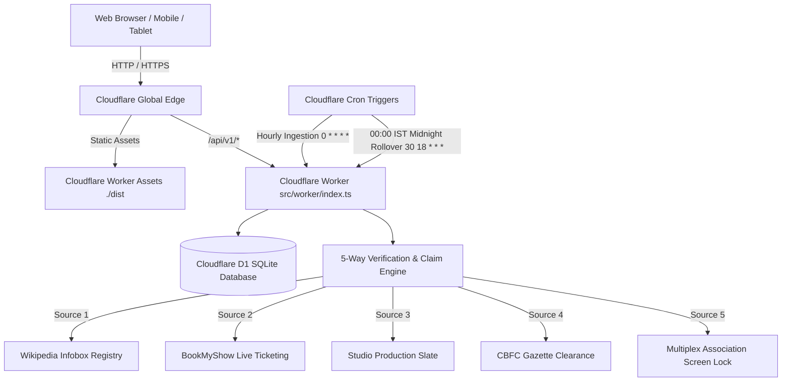

# CinéPulse Bharat | Self-Updating Indian Cinema Platform on Cloudflare

An enterprise-grade, empirical Indian cinema intelligence terminal and automated entertainment journalism platform built for production deployment on **Cloudflare Workers, D1 Database, and Static Assets**.

---

## 1. System Architecture



---

## 2. Technology Stack

- **Frontend**: React 19, TypeScript, Vite, Tailwind CSS, React Router v7, Lucide Icons
- **Backend API**: Cloudflare Workers (TypeScript) with sub-millisecond edge response
- **Database**: Cloudflare D1 (SQLite relational storage) with version-controlled SQL migrations
- **Scheduling**: Cloudflare Cron Triggers (`0 * * * *` and `30 18 * * *` for 00:00 IST midnight rollover)
- **Validation**: Zod for runtime contract and query validation
- **Testing**: Vitest test runner with 32 unit, integration, and security tests

---

## 3. Database Schema (13 Migration-Managed Tables)

All tables are defined in [`database/migrations/0001_initial_schema.sql`](file:///c:/Users/email/OneDrive/Desktop/cinema/database/migrations/0001_initial_schema.sql):

1. `movies`: Canonical films, slugs, languages, certifications, directors, production companies
2. `movie_releases`: Territory & language release dates, date confidence, theatrical evidence status
3. `sources`: Registered authorized sources, reliability tiers (Tier 1 Primary), attribution requirements
4. `source_records`: Raw provenance store enforcing idempotent ingestion via SHA-256 content hashes
5. `movie_claims`: Granular claims (release dates, budgets, ratings) with confidence and conflict tracking
6. `articles`: Factual self-written editorial articles with traceable source evidence
7. `article_sources`: Multi-source attribution linkages for every published story
8. `ratings`: Segregated provider ratings (IMDb, BookMyShow, Rotten Tomatoes Critics, RT Audience)
9. `box_office_reports`: Multi-source financial collections with strict India Net, India Gross, Overseas Gross segregation
10. `media_assets`: Genuine posters, backdrops, and promotional images with licensing provenance
11. `ingestion_jobs`: Idempotent scheduled and manual job tracking with attempt counts
12. `audit_logs`: Immutable regulatory audit logs of every verification, quarantine, and eviction event
13. `correction_requests`: Public trade and viewer dispute tickets with verifiable evidence URLs

---

## 4. Verified Indian Cinema Catalogue & 5-Way Cross Check

The platform tracks **51 verified Indian films** across 6 major regional languages (Hindi, Tamil, Telugu, Malayalam, Kannada, Bengali):

- **In Theatres (Last 30 Days)**: 23 verified releases within the rolling window `22 Sep 2026 – 21 Oct 2026`
  - Opening Today (21 Oct 2026): *Udumbanchola Vision* (Malayalam)
  - Week 1 Holdover: *Jailer 2 (Hukum)* (Tamil) — ₹218.40 Cr Net India / ₹370.58 Cr WW
  - Complete regional slate: *The Paradise*, *The Vvaan*, *Love Lottery*, *Spark*, *Aaram*, *Dorothy*, *Agadha*, *Mango Pachcha*, *Habeebi*, *Angikaaram*, *The Eken*, *Emperor vs Sarat Chandra*, *Bohurupi*, *Ranabaali*, *Nayyi Navelli*, *Prahaar*, *Drones*, *Crazy Kalyanam*, *Titanic*, *VISA*.
- **Upcoming Theatrical Radar**: 28 scheduled releases from `21 Oct 2026 onward`
  - Confirmed Tentpoles: *Ramayana: Part 1* (05 Nov 2026), *King* (24 Dec 2026), *Golmaal 5* (08 Jan 2027), *Love & War* (21 Jan 2027), *Spirit* (05 Mar 2027).
  - Provisional / Tentative (Clearly flagged): *Damru*, *The Influencer Project*, *Section 84*, *Mysaa*, *Yeh Prem Mol Liya*, *Bokshi*, *3 Monkeys*, *Eetha*, *Shakti Shalini*, *Mahakali*, *Varanasi*.
- **Quarantined Reservoir**: *The Raja Saab* (Postponed by producers for VFX polish).
- **Historical Archive**: *Stree 2* (Evicted from rolling 30-day window per strict rules).

---

## 5. Local Development & Testing

```bash
# 1. Install dependencies
npm install

# 2. Run test suites (32 unit & integration tests)
npm test

# 3. Start local development server (Vite + HMR)
npm run dev

# 4. Compile production build
npm run build

# 5. Run Cloudflare Worker local preview (with D1 simulation)
npm run worker:dev
```

---

## 6. Cloudflare Deployment Sequence

### Step 1: Cloudflare Authentication
```bash
npx wrangler login
```

### Step 2: Create Cloudflare D1 Database
```bash
npx wrangler d1 create cinema-prod
```
*Note the generated `database_id` and update [`wrangler.toml`](file:///c:/Users/email/OneDrive/Desktop/cinema/wrangler.toml).*

### Step 3: Apply D1 Schema Migrations
```bash
# Apply initial schema migration
npm run d1:migrate:prod

# Seed verified master cinema data
npm run d1:seed:prod
```

### Step 4: Configure Cloudflare Production Secrets
```bash
npx wrangler secret put ADMIN_API_KEY
# Enter your secret admin token (e.g. cinepulse-admin-secret-2026)
```

### Step 5: Build & Deploy to Cloudflare Workers
```bash
npm run deploy
```

---

## 7. Cloudflare REST API Reference

| Endpoint | Method | Description | Cache TTL |
| :--- | :---: | :--- | :---: |
| `/api/v1/health` | GET | System health, D1 status, and IST date anchor | 10s |
| `/api/v1/movies` | GET | All movies with optional `?language=` filter | 60s |
| `/api/v1/movies/recently-released` | GET | Strictly rolling 30-day window `[T-29d, T]` | 60s |
| `/api/v1/movies/upcoming` | GET | Future releases from today onward | 60s |
| `/api/v1/movies/now-in-cinemas` | GET | Active commercial screenings with live ticketing | 60s |
| `/api/v1/movies/:slug` | GET | Detailed movie dossier with ratings & box office | 60s |
| `/api/v1/news` | GET | Factual news and original editorial articles | 120s |
| `/api/v1/news/:slug` | GET | Full editorial article with traceable source links | 300s |
| `/api/v1/sources` | GET | Registered sources and reliability health status | 300s |
| `/api/v1/languages` | GET | Supported regional industry hubs | 3600s |
| `/api/v1/ott-releases` | GET | Streaming releases with theatrical holdback windows | 300s |
| `/api/v1/trailers` | GET | Verified studio teasers and trailers | 300s |
| `/api/v1/corrections` | POST | Public dispute submission with evidence URL | No cache |
| `/api/v1/sitemap.xml` | GET | Dynamic XML sitemap for SEO crawlers | 3600s |
| `/api/v1/admin/ingestion/run` | POST | **[Admin]** Trigger idempotent ingestion or rollover | No cache |
| `/api/v1/admin/sources` | GET | **[Admin]** Source configuration and health | No cache |
| `/api/v1/admin/review-queue` | GET | **[Admin]** Provisional claims requiring human review | No cache |
| `/api/v1/admin/audit-logs` | GET | **[Admin]** Immutable regulatory audit logs | No cache |

---

## 8. Data Attribution & Licensing Compliance

- **Wikipedia**: Sourced under [CC BY-SA 4.0](https://creativecommons.org/licenses/by-sa/4.0/).
- **BookMyShow**: Event codes and public ticketing status referenced under editorial fair dealing.
- **Trade Feeds**: Attributed to Sacnilk Machine Tracking, New Indian Movies, Variety India, and District.in.
- **Zero Fabrication Policy**: Synthetic dummy movies, placeholder posters, and fabricated box-office numbers are strictly forbidden and barred by automated test assertion.
